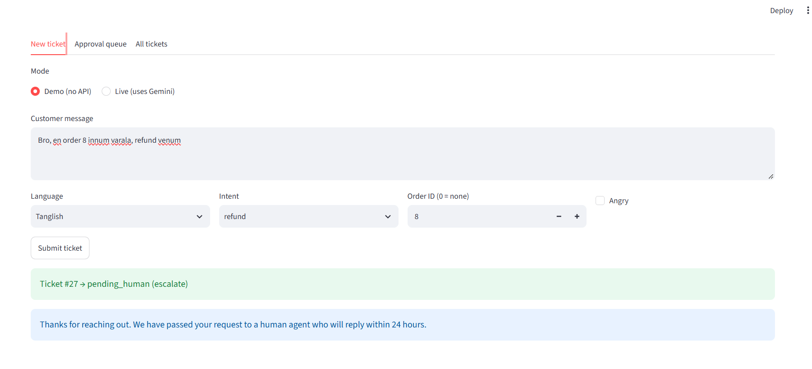
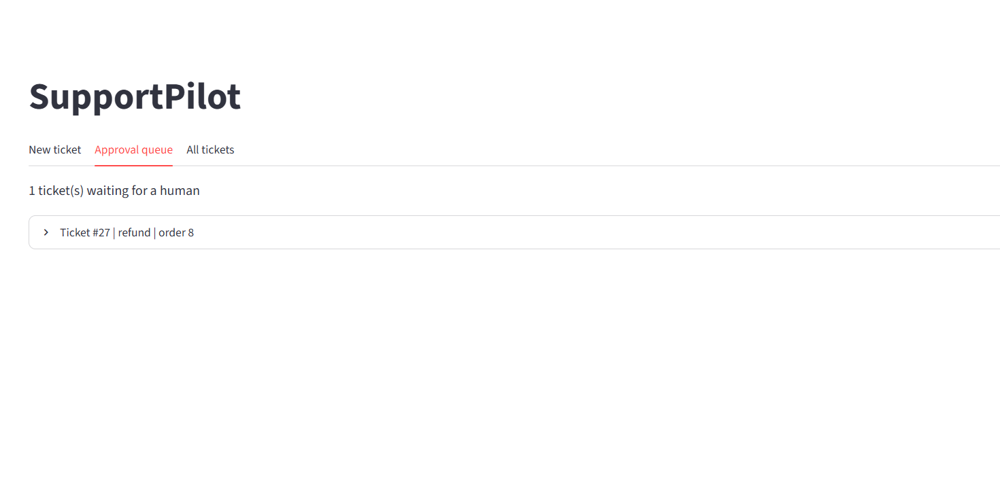
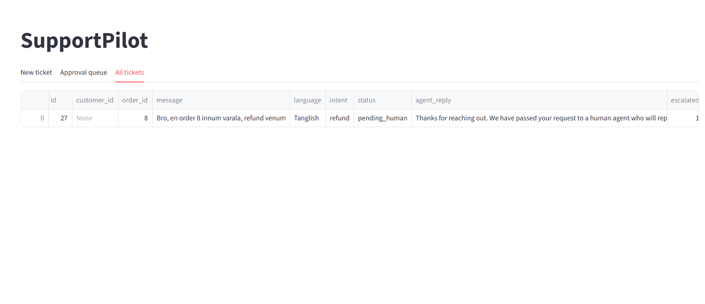
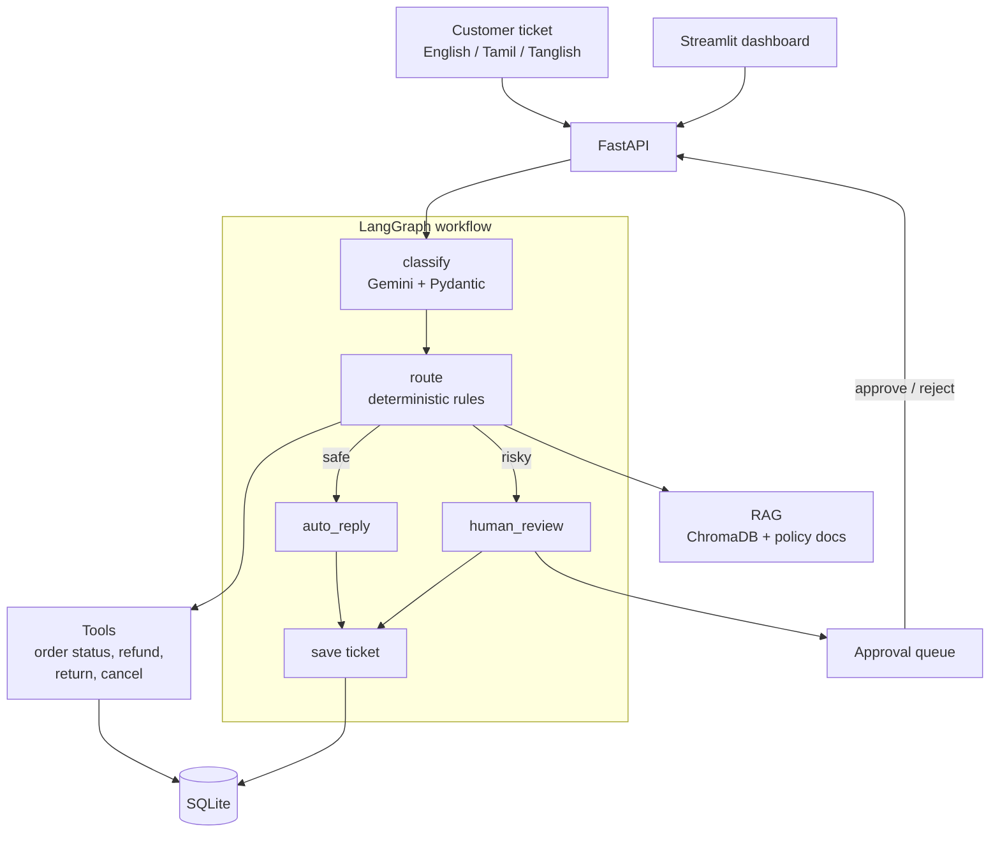

# SupportPilot: Multilingual AI Support Agent for E-commerce

An agentic AI system that reads customer tickets in **English, Tamil and Tanglish**, resolves them using real tools (order status, refund, return, cancel), answers policy questions with RAG, and **escalates risky cases to a human**.

> Built on mock data as a portfolio project. For production, only the orders database and policy documents need to be replaced.

## Problem
Support teams spend most of their time on repetitive tickets: order status, refunds, policy questions. Basic chatbots only answer FAQs, can't take actions, and often fail on regional languages like Tamil and Tanglish (Tamil written in English letters).

## Screenshots





## System design



| Layer | What it does | Tech |
|---|---|---|
| Interface | Dashboard for tickets and human approval, REST API for integration | Streamlit, FastAPI |
| Orchestration | Runs the steps and branches on risk | LangGraph |
| LLM layer | Understands the message (language, intent, order ID, anger) and translates replies | Gemini, LangChain, Pydantic |
| Decision layer | Business rules decide the action | Plain Python |
| Tools | Act on orders and refunds | Python functions |
| Knowledge | Policy search | ChromaDB, MiniLM embeddings |
| Storage | Customers, orders, refunds, tickets | SQLite |

## Workflow
1. **Classify (LLM):** detects language, intent, order ID and anger, and rewrites the message in English so RAG works for Tamil and Tanglish.
2. **Route (deterministic rules):** decides the action. The LLM never decides money-related actions.
3. **Tools / RAG:** order status, refund, return, cancel, plus policy search over ChromaDB.
4. **Reply writer:** replies are built from templates, so amounts and order IDs can't be hallucinated. The LLM only translates them for Tamil and Tanglish customers.
5. **Human review:** angry customers, complaints and refunds above Rs 2000 go to an approval queue.
6. **Save:** every ticket is stored with its status and reply.

## Design decisions
- **LLM understands, rules decide.** Money actions never depend on the LLM, which keeps the agent predictable and testable.
- **Template replies.** Facts come from the database, not from the model.
- **English query for RAG.** The embedding model is weak on Tamil, so the classifier rewrites the query in English before retrieval.
- **Human in the loop.** Risky cases wait in an approval queue.
- **Duplicate refund guard.** A customer can't be paid twice for the same order.
- **Graceful failure.** If the LLM is unavailable or rate limited, the reply falls back to the English template and the API returns a clear 503.
- **Cached evals.** Classifier results are cached, so the same call is never paid for twice.

## Tech stack
Python, LangGraph, FastAPI, Gemini API, LangChain, ChromaDB (RAG), SQLite, Streamlit, Pydantic, Docker

## API
FastAPI docs are available at `/docs` when the server is running.

| Endpoint | Purpose |
|---|---|
| `POST /tickets` | Submit a ticket (classified by Gemini) |
| `POST /tickets/demo` | Submit a ticket with a given classification (no LLM call) |
| `GET /tickets` | List all tickets |
| `GET /tickets/pending` | Tickets waiting for a human |
| `POST /tickets/{id}/approve` | Human approves a ticket |
| `POST /tickets/{id}/reject` | Human rejects a ticket |

## Evaluation

| Test | Result |
|---|---|
| Router logic (22 scenario tests: refund limits, duplicates, cancel rules, policy routing) | 22/22 passed |
| Classifier, 20 of 30 original hand-labeled tickets (11 Tanglish, 7 Tamil, 2 English) | Language, intent, order ID and anger: 100% |
| Classifier, held-out tickets written after the prompt was fixed | X% (to be filled after running) |

**Finding:** the first prompt scored 90% intent accuracy (19/21). It misread policy questions such as "how long does a refund take?" as refund or return actions, which could trigger a real refund. Adding explicit intent rules fixed both cases.

**Limitations:**
- The test set is small and labeled by me
- The first 30 tickets were seen while fixing the prompt, so the held-out set is the fairer number
- Data is mock, and the free Gemini tier limits how many tickets can be classified per day

## Production path
- Postgres instead of SQLite, and the real orders API instead of the mock tools
- A queue (Redis or Celery) with workers for ticket processing
- Caching for repeated questions to cut LLM cost
- Authentication and rate limiting on the API
- Tracing and monitoring (Langfuse): escalation rate, cost per ticket
- A stronger multilingual embedding model for better Tamil retrieval

## Run it locally
```bash
pip install -r requirements.txt
python -m data.seed_orders
python -m app.rag.ingest
```
Create a `.env` file:
```
GOOGLE_API_KEY=your_key
MODEL_NAME=your_gemini_model
```
Then start the dashboard or the API:
```bash
streamlit run ui/app.py
uvicorn app.main:app --reload
```

### With Docker
```bash
docker build -t supportpilot .
docker run -p 8501:8501 --env-file .env supportpilot
```

## Run the evals
```bash
python -m evals.run_evals          # router, no API calls
python -m evals.classifier_eval    # classifier, uses Gemini (results are cached)
```

## Project structure
```
app/agents/   classifier, router, reply writer
app/tools/    orders, refunds, tickets
app/rag/      ingest, retriever
app/graph.py  LangGraph workflow
app/main.py   FastAPI backend
ui/           Streamlit dashboard with approval queue
evals/        router and classifier evals, labeled tickets
data/         seed script and policy documents
docs/         screenshots
```

## Next steps
- Grow the labeled set to 100+ tickets
- LLM-generated policy answers from the top retrieved chunks
- Tracing with Langfuse
- Live deployment

## Author
Ashik | [GitHub](https://github.com/ashik230509) | [LinkedIn](https://linkedin.com/in/ashik-t)