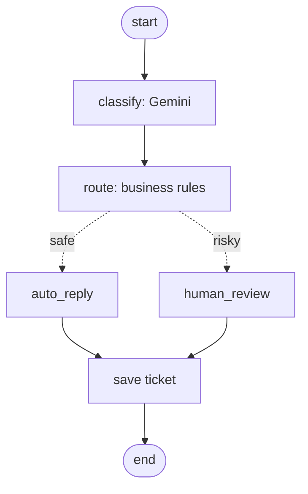

# SupportPilot: Multilingual AI Support Agent for E-commerce

An agentic AI system that reads customer tickets in **English, Tamil and Tanglish**, resolves them using real tools (order status, refund, return, cancel), answers policy questions with RAG, and **escalates risky cases to a human**.

> Built on mock data as a portfolio project. For production, only the orders database and policy documents need to be replaced.

## Problem
Support teams spend most of their time on repetitive tickets: order status, refunds, policy questions. Basic chatbots only answer FAQs, can't take actions, and often fail on regional languages like Tamil and Tanglish (Tamil written in English letters).

## Workflow

1. **Classify (LLM):** detects language, intent, order ID and anger, and rewrites the message in English so RAG works for Tamil and Tanglish.
2. **Route (deterministic rules):** decides the action. The LLM never decides money-related actions.
3. **Tools / RAG:** order status, refund, return, cancel, plus policy search over ChromaDB.
4. **Reply writer:** replies are built from templates, so amounts and order IDs can't be hallucinated. The LLM only translates them for Tamil and Tanglish customers.
5. **Human review:** angry customers, complaints and refunds above Rs 2000 go to an approval queue.
6. **Save:** every ticket is stored with its status and reply.

## Safety design
- Refunds above Rs 2000, non-delayed orders, complaints and angry customers are escalated to a human
- Duplicate refund requests are blocked
- Facts in replies come from the database, not from the LLM
- If the LLM is unavailable or rate limited, the reply falls back to